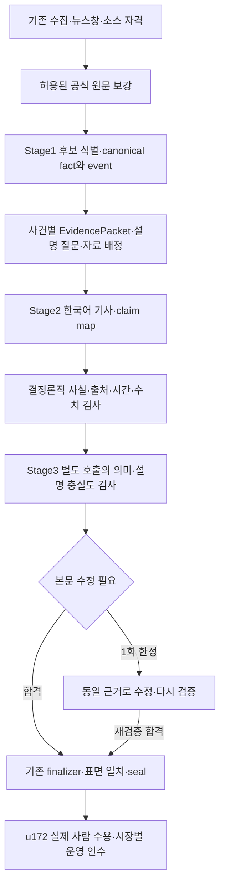

# 실제 자동 생성 기사의 내용 충실도 설계

2026-10-26. 기준 코드 `02a5ad7a`. **설계 작성, 구현 0; 운영 설정 변경 없음.** 사용자가 승인한 기사형 편집과 하단 안내 배치를 실제 자동 생성물에서도 달성하기 위한 v3 후속 설계다. 설계 요청을 실행·소스 접근·배포 완료로 기록하지 않는다.

## 목표와 완료선

독자는 사건별 기사에서 무엇이 달라졌고, 적용 범위와 확인된 맥락이 무엇이며, 왜 중요한지 이해할 수 있어야 한다. 문단을 기본으로 하되 비교 수치·절차·조건은 주제에 맞게 표나 목록으로 분리한다. `사건/배경/의미/반응`은 독자에게 강제하는 목차가 아니다. 일반 자료 안내와 canonical 면책은 마지막에, 해당 주장에 필요한 조건·불확실성과 출처는 기사 안에 둔다.

완료는 HTML에 긴 글이 보이는 것이 아니다. **실제 수집 → 실제 모델 → 단일 finalizer → 최종 독자 출력**을 변경 없이 검수한 u172 실제 corpus가 합격하고, 승인된 시장별 운영 인수가 끝나야 한다. 개발자가 쓴 reference, 녹화 재생, 모델 자체 평가, 코드 CI는 각각 별도 증거다.

## 문제를 확인한 근거

| 관측 | 의미 | 기존 증거 / 코드 |
| --- | --- | --- |
| 실제 `40125141798`: 미국 174개 입력 중 Stage1 24,154 bytes에 FRED 4개·일정 6개, 뉴스 0개 | 수집 성공과 모델 전달 성공이 다름. 기존 입력 선정 수리는 재사용 | [분석](../event-news-v3/content-quality-repair-20261025.md) |
| 실제 `40186613927` / `b06147c9`: 324개 수집·174개 라우팅, 모델 2회, 최종 미국 기사 1개·원문 주장 125자, 배경 없음 | 뉴스 입력 보호만으로 충분한 기사가 되지 않음 | [실행 기록](../../../docs/sessions/2026-10-25-event-v3-content-quality.md) |
| `scripts/preview_event_briefing.py`가 수집 items를 바로 GenerationInput에 전달 | 프리뷰에는 기존 body 보강 연결이 없음 | `run_preview`의 request 구성 경로 |
| production `pipeline.py`는 enrichment를 uses_v2에만 연결하고 v3 active enrichment를 거부 | 환경 변수만 켜서 해결할 수 없음 | `_enrich_collected_events`, CollectStage, run pipeline validation |
| source excerpt 1,200자, ContextRef 240자, Stage2 16KiB; optional meaning/reaction 먼저, background 뒤 | 원문·설명 자료가 입력 중간에서 손실될 수 있음 | `models/enrichment.py`, `_internal/event_context.py` |
| what_changed는 완전한 원문 assertion을 그대로 쓰도록 유도. background/meaning/reaction 각 180자 | 문장 검증의 정확성과 자연스러운 한국어 설명을 분리할 필요 | `briefing/event_document.py`, `_internal/event_v3_contract.py` |
| `35d1dcca` 산문, `658be680` footer, `61625360` 사용자 승인 기록 | **표현 정책은 완료된 기반**. 같은 renderer 수리 유닛을 다시 만들지 않음 | [승인 정책](../event-news-v3/article-first-editorial-policy-20261025.md) |

기준 worktree의 최신 공개 archive는 국내 2026-10-09, 미국·크립토 2026-10-23이며 세 문서 모두 schema3 marker가 없다. quality history/coverage는 기존 발행의 관측 자료다. 이 archive를 새 자동 기사 품질의 양성 사례로 세지 않는다. 실제 v3 최신 분석은 위 private preview 기록에 한정하며, 당시 source 실패를 현재 모든 소스의 상태로 일반화하지 않는다.

## 선택한 아키텍처

Stage3는 **같은 기존 CLI runner의 추가 호출**이며 다른 유료 API/별도 서비스가 아니다. 독립된 호출일 뿐 통계적으로 독립된 모델이나 사람 검수라는 뜻은 아니다. 새 호출·예산·본문 계약은 아래 문서에 고정한 **설계 개정**이다. 기존 C1/C4/C7의 두 단계 규칙을 몰래 무시하지 않는다. 기본 profile은 기존 `role_v1`이며 새 `article_v2`는 개발·비게시 검증을 거친 뒤 u172 release 대상으로 전달한다.

| 결정 | 채택 이유 / 포기한 대안 |
| --- | --- |
| ADR-184: 기존 u161 fetch owner를 v3에도 연결하고 passage selection을 확장 | feed만 길게 쓰게 지시해도 없는 근거는 생기지 않음. 새 범용 crawler·모델 URL 탐색은 도입하지 않음 |
| ADR-185: 원문 assertion과 독자용 한국어를 분리하고 모든 문장을 claim에 연결 | 영어 원문 복사를 유일한 proof로 쓰면 자연스러운 설명이 막힘. 자유 Markdown을 검증 없이 받는 방식은 제외 |
| ADR-186: hard gate + 별도 semantic review + 최대 1회 수정 | 문자열 검사만으로 번역·종합 설명의 의미를 증명할 수 없음. 자기 점수만으로 공개하거나 무한 재시도하는 방식은 제외 |
| ADR-187: 내용 충실도와 trust·수집 상태를 별도 계측 | `source_limited`, 글자 수, 역할 칸 수가 독자의 이해를 대신하지 않음. 부족 원인은 원천·선정·작성·검증으로 구분 |
| ADR-188: 공개 schema3 유지, content contract version 2 명시 | 과거 bytes/hash는 보존하고 새 본문 구조를 명시적으로 읽음. 구형 필드에 긴 글을 숨기는 방식은 제외 |

## 유닛과 중복 정리

| 범위 | 기존 owner와 재사용 | 이번 작업 |
| --- | --- | --- |
| 뉴스창·소스 상태·body 권한 | u160/u161/u165/u173 | u184는 v3 handoff·passage 배정만 확장. source qualification과 새 adapter 개발을 대신하지 않음 |
| canonical identity/fact/time/story | u167/u168/u170 | 기존 타입·검증 재사용. 새 사건 ID나 두 번째 ledger 없음 |
| 기사·요약·모든 독자 표면 | u169/u171, 승인된 prose/footer | u185는 typed narrative와 claim binding 확장. 완성된 배치 수리를 재등록하지 않음 |
| 의미 검사·제한된 수정 | 기존 u169 runner/gates, u159/u172 평가 | u186는 새로운 Stage3와 전역 예산·준비도 연결 |
| 실제 corpus·사람 검수·viewport·운영 전환·cleanup | u172/u171 | 기존 미완료 작업을 계속 사용. 새 합격 스코어나 중복 rollout 유닛 없음 |
| finalizer·publication·인증 | u144/u155/u113 | 단일 finalizer, 기존 runner와 remote transaction 유지 |
| 성능 | NFR-001, DEBT-090 | 측정 확대. 설계 상한을 성능 목표 달성으로 기록하지 않음 |

신규 구현 단위는 **u184 → u185 → u186 → u172 실제 인수**다. u173 자격검증은 u184의 실제 입력 공급과 함께 진행할 수 있지만, qualification이 없는 소스의 HTTP/공개 경로를 열지 않는다. 제한된 허용 소스로 하는 개발을 8개 slot 전체 완료까지 막지 않으며, 최종 시장 인수의 source 기준은 완화하지 않는다.

- [u184 근거 패킷](../plans/u184-event-evidence-packet-completion-code-generation-plan.md)
- [u185 근거 기반 기사 작성](../plans/u185-claim-grounded-article-composition-code-generation-plan.md)
- [u186 의미 검증과 제한된 수정](../plans/u186-article-semantic-review-and-readiness-code-generation-plan.md)

## 설계 문서

- [처리 흐름·모듈 소유권](functional-design/business-logic-model.md)
- [작성·검증·실패 규칙](functional-design/business-rules.md)
- [타입·version·근거 계약](functional-design/domain-entities.md)
- [고정 예산·보안·성능](nfr-requirements/nfr-requirements.md)
- [실제 기사 수용과 인계](acceptance-and-handoff.md)
- [로컬 설계 검토 결과](review-resolution.md)

새로운 설계가 기존 계약과 다른 부분은 **`article_v2`에 한정**해 본 program의 규칙을 우선한다. 기존 profile·schema2·과거 발행의 계약은 변경하지 않는다. 현재 production pin/preview pin/source policy를 문서 작업으로 바꾸지 않는다.
