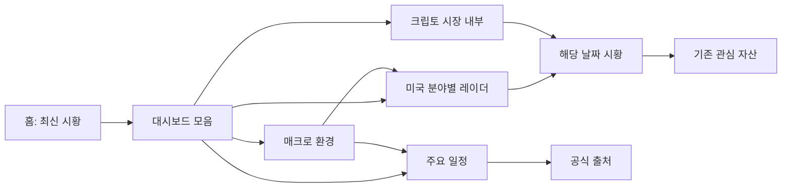

# 공개 정보·인사이트 화면 확장 기획

작성일: 2026-10-11 · 기준 코드: `origin/main` `55c00fc85e2828f62cd69d5583afd3761ef86d45`

상태: 제품 제안과 우선순위 검토 완료. 신규 화면의 개발·운영 활성화는 이번 작업 범위에 포함하지 않는다. 이 문서는 기존 AIDLC 유닛을 승인하거나 새로운 Ready 유닛을 등록하는 문서가 아니다.

## 1. 추천 방향

첫 확장은 **매크로 환경판 → 이번 주 주요 일정 → 크립토 시장 내부** 순서로 진행한다. 기존 분야별 레이더가 “어디가 상대적으로 강한가”를 보여주므로, 추가 화면은 “시장 배경이 어떠한가”, “다음에 무엇을 확인할까”, “가격 외에 어떤 변화가 있는가”를 풀어준다.

다음 단계는 **선물 포지션 지도**다. **분야별 흐름 이력**은 기존 레이더의 탭으로 추가하고, **이슈 추적 보드**는 이미 진행 중인 event/news v3의 story·reader 계약이 완성된 뒤 연결한다.

사용자는 한국에 거주하며 국내 증시·미국 증시·크립토를 함께 보는 개인 투자자다. 아침에 1분 정도 확인하고, 관심 있는 변화만 시황·원출처로 더 읽는 사용을 기본으로 한다. 로그인·계좌 연결 없이 공유 가능한 정적 화면과 월 0원 운영 예산을 유지한다.

## 2. 실제 공개 상태와 활용 가능한 재료

2026-10-11에 원격 코드, 배포 Actions, 실제 HTML/JSON을 확인했다. 로컬 루트는 원격보다 38커밋 뒤에 있어 원격 최신 코드를 별도 작업 트리에서 읽었다.

| 현재 기능 | 확인한 상태 | 추가 기획에 주는 의미 |
| --- | --- | --- |
| [미국 분야별 레이더](https://murphygo.github.io/investo/sectors/) | HTTP 200. schema 3, 기준일 2026-10-09. 14개 분야 그룹·11개 섹터 모두 비교 가능 | 같은 순위표를 다른 이름의 신규 화면으로 만들 필요가 적다 |
| 분야 비교와 시장 요약 | 상대성과, 상대 가속, 국면, 변동성, 낙폭 제공 | 다음 확장은 시장 배경과 시간에 따른 변화에 집중한다 |
| 홈·시장별 시황·아카이브 | 최신 발행 상태, 시장별 링크, 월별 탐색 구현 | 대시보드에서 관련 날짜의 시황으로 연결할 수 있다 |
| 관심 자산 | 오늘의 영향과 자산별 누적 페이지 존재 | 새 종목 뉴스 피드는 기존 기능과 중복된다 |
| 사건 추적·자산 영향 | u170/u171에 이미 설계됨. 상태 문서상 아직 Planned | 이슈 추적 화면은 이 모델의 소비자로 기획한다 |
| 화면 이력 데이터 | 분야별 공개 파일은 `latest.json` 중심. 장기간 화면용 이력 저장은 없음 | 30일·1년 차트가 이미 준비됐다고 가정할 수 없다 |

라이브 분야별 JSON과 HTML의 snapshot ID는 `sha256:8a1e76ae65b4c8514a7c541ac31acdba69bb55556fd6a9dad0fe2b7b0fe3604a`로 일치한다. 확인한 최신 Pages 실행은 [38044709772](https://github.com/murphyGo/investo/actions/runs/38044709772), 데이터 갱신 실행은 [38036114019](https://github.com/murphyGo/investo/actions/runs/38036114019)이며 모두 success다.

`archive/_meta/coverage.jsonl`에서 발행일별 마지막 기록을 골라 최근 10개 날짜인 2026-09-28~2026-10-09를 확인했다.

| 소스 묶음 | 기록상 데이터 반환 | 제한 |
| --- | --- | --- |
| Treasury 금리, NY Fed 기준금리, FRED 매크로·원달러 | 각각 10/10 `ok` | 값의 타당성·시점·공개 사용 조건까지 통과했다는 뜻은 아니다 |
| FOMC, FRED 경제일정, BEA 일정, Nasdaq 실적일정 | 각각 10/10 `ok` | date-only 일정과 정확한 시각을 가진 일정이 섞여 있다 |
| CFTC COT | 10/10 `ok` | 주간 선물 보유 포지션. 실시간 매매·자금 유입과 다르다 |
| DeFiLlama, CoinGecko global, Bybit, OKX | 각각 10/10 `ok` | 거래소별·조회 시점별 관찰을 전체시장·하루 평균으로 확대할 수 없다 |
| CBOE 변동성, KRX 외국인 수급 | 각각 10/10 `zero` | 첫 화면의 필수 지표로 쓰기 어렵다 |
| FSC 국내 지수 가격 | `zero` 9회, `failed` 1회 | 최신 소스 수리·자격 검증과 실제 운영 반영을 구별해야 한다 |

이 결과는 **10개 날짜의 기록**이며 현재 SHA로 수행한 10회 수용 시험이 아니다. 신규 화면의 안정성을 확정하는 근거로 쓰지 않는다. 분석 요약은 [검토 근거 JSON](public-insights-evidence-20261011.json)에 보관한다.

## 3. 후보 비교

우선순위는 기존 화면과의 차별성, 반복 방문 가치, 현재 데이터 활용도, 구현 부담을 함께 판단한 제품 제안이다. 측정된 사용자 수요나 수익 예측을 뜻하지 않는다.

| 순위 | 화면 | 독자가 얻는 답 | 첫 출시 구성 | 데이터 준비도 | 판단 |
| ---: | --- | --- | --- | --- | --- |
| 1 | 매크로 환경판 | 금리·환율·경제지표 배경이 어떤가 | 주요 금리 카드, 4개 만기 비교, 원달러, 최신 물가·고용 | 기존 어댑터 있음. 화면용 이력은 추가 필요 | 첫 개발 추천 |
| 2 | 이번 주 주요 일정 | 언제 무엇을 확인해야 하는가 | 7일 일정 목록, 이벤트 종류 필터, 공식 일정 링크 | 기존 일정 소스 있음. 시각 정밀도 보완 필요 | 첫 개발 추천 |
| 3 | 크립토 시장 내부 | 가격 외 시장 규모·공급·파생상품 상태는 어떤가 | 스테이블코인 공급, TVL, BTC 점유율, 거래소별 펀딩·OI | 기존 수집 있음. 시간·단위·공개 표시 조건 보완 필요 | 조건부 첫 출시 |
| 4 | 선물 포지션 지도 | 보고 대상 선물 참가자들의 보유 포지션은 어떤가 | 9개 계약 순포지션·OI 비율, 보고 기준일, 참가자 구분 | 기존 CFTC 어댑터 있음. 주간 이력 추가 필요 | 두 번째 묶음 |
| 5 | 분야별 흐름 이력 | 최근 어떤 분야의 상대강도·국면이 바뀌었나 | 날짜별 히트맵, 국면 변화, 두 날짜 비교 | 기존 파생값 재사용. 긴 이력은 없음 | 기존 레이더 확장 |
| 6 | 이슈 추적 보드 | 지난 이슈에서 확인된 변화와 남은 질문은 무엇인가 | 진행 중 사건, 새 사실, 다음 확인, 종료 근거 | u168~u172 선행 작업 필요 | 기존 v3에 연결 |

## 4. 화면별 상세 기획

### 4.1 매크로 환경판 — `/insights/macro/`

**핵심 사용 장면:** 섹터 레이더에서 기술주가 강해졌을 때, 금리·환율 상황도 함께 확인한다. 가격 움직임의 원인을 자동으로 단정하지 않는다.

위에서 아래로 다음 순서로 읽힌다.

1. **현재 주요 값:** 미 국채 2년·10년, 10년−2년 스프레드, 원달러. 카드마다 관측 기준일·출처·단위 표시.
2. **만기별 금리:** 같은 날짜의 3개월·2년·10년·30년 네 점 비교. “4개 만기 비교”로 명명하고 전체 수익률곡선이라고 표시하지 않는다.
3. **단기 자금시장:** SOFR와 EFFR, 동일 유효일일 때만 두 금리 차이를 bp로 표시.
4. **최신 물가·고용:** BLS/FRED의 검증된 실제 값과 대상 월. CPI 지수와 물가 상승률을 구별하고 기존 canonical macro fact의 단위·원천 우선순위를 따른다.
5. **확인할 연결:** 이번 주 주요 일정과 같은 날짜 미국 시황, 기존 분야별 레이더 링크.

첫 버전은 검증된 현재 값과 만기 비교만으로 공개 가능하다. 5거래일 변화와 최근 30개 관측 차트는 같은 지표의 비교 가능한 이력이 축적된 뒤 붙인다. 비교 시점이 없으면 “이력 축적 중”으로 표시한다.

**독자용 문장 예시:** “10년−2년 금리차는 [검증 값]bp입니다. 두 값의 기준일은 [날짜]입니다.” 금리 상승으로 특정 자산이 하락했다는 사건 인과는 시황의 검증된 근거가 있을 때 해당 시황 링크로 설명한다.

**필수 계약:** 1pp=100bp. 서로 다른 기준일의 금리로 스프레드를 만들지 않는다. 원달러는 달러 지수로 표시하지 않는다. 월간 경제지표는 대상 월과 조회일을 구별한다. VIX·MOVE·신용스프레드·금리 인하 확률·합성 위험점수는 첫 범위에서 제외한다.

### 4.2 이번 주 주요 일정 — `/insights/calendar/`

**핵심 사용 장면:** 일요일 또는 아침에 CPI·고용·FOMC·국채 입찰·관심 기업 실적을 날짜순으로 확인한다.

기본은 **7일 목록**, 선택 가능한 보조 범위는 30일이다. 모바일에는 가로 달력 대신 날짜별 카드 목록을 보여준다. 필터는 경제지표·중앙은행·실적·국채 입찰이며, 관심 기업 실적은 기존 watchlist를 재사용한다.

카드는 `원출처 기준 날짜/확인된 한국 시각 → 일정명 → 대상 기간 → 왜 확인하는지 → 공식 출처` 순서다. 일반적인 중요성을 설명하는 고정 가이드와 현재 사건의 시장 영향을 구별한다. 전자는 “이 지표가 측정하는 것” 정도로 제한한다.

**첫 공개 범위:** 기존 FOMC·FRED·BEA·Treasury 일정. Nasdaq 실적일정은 공개 표시 조건을 확인한 뒤 선택 영역에 연결한다. BLS 공식 ICS는 정확한 CPI·고용 시각을 보강할 후보로 검토하며, 기존 어댑터라고 기록하지 않는다. [BLS는 공식 iCalendar를 제공한다](https://www.bls.gov/help/hlpiCAL.htm).

**필수 계약:** FRED 어댑터의 date-only 값을 표현하기 위한 UTC 자정은 실제 발표시각이 아니다. 이를 한국 오전 9시 발표로 렌더하지 않는다. 정확한 시각이 없으면 원출처 현지 날짜와 “시간 미정”을 표시하고 시간 단위 카운트다운을 생략한다. 정확한 ET 시각만 DST를 반영해 KST로 변환한다.

날짜가 지났다는 이유로 “발표 완료”를 표시하지 않는다. 첫 버전은 예정 일정 조회에 한정하고 발표 결과는 해당 출처·시황 링크로 연결한다. 이후 실제치 카드 연결은 canonical event key와 대상 기간이 일치할 때만 추가하며 DEBT-079의 schedule/actual 중복 문제를 먼저 해결한다. 컨센서스·서프라이즈는 확보된 원천이 없어 제공하지 않는다.

### 4.3 크립토 시장 내부 — `/insights/crypto/`

**핵심 사용 장면:** BTC 가격 변화와 함께 시장 규모, 스테이블코인 공급, DeFi 규모, 파생상품 관찰을 확인한다.

첫 화면의 세 패널은 다음과 같다.

| 패널 | 카드 | 해석 범위 |
| --- | --- | --- |
| 시장 규모 | BTC 점유율·전체 시가총액 | CoinGecko 집계 범위·원출처 기준시각 표시 |
| 공급·활동 참고 | USD 연동 스테이블코인 공급·체인 TVL 합계 | 공급 변화는 자금 유입 확정값이 아니다. TVL은 가격과 집계방식의 영향을 받는다 |
| 파생상품 | BTC 펀딩비·미결제약정 | Bybit 또는 OKX의 해당 계약·조회 시점 관찰이며 전체 거래소 합계가 아니다 |

처음에는 현재 값만 제공한다. 7일 변화·30일 차트는 동일 정의·동일 제공자·동일 관측 정책의 이력이 있어야 열며, 결측 구간은 비워 둔다. Fear & Greed는 출처를 명시한 보조 카드이며 사이트 자체의 위험 등급으로 변환하지 않는다.

**출시 선행조건:** 현재 OKX 어댑터는 `published_at`에 수집 window 종료시각을 사용하고 펀딩·OI 제목에 `UTC 24h`를 붙인다. 이 값은 24시간 평균이나 변화율이라는 근거가 아니다. 새 공개 화면에는 실제 조회시각, 응답의 `ts`, 펀딩 적용시각·정산 여부·계약을 구별하는 projection이 필요하다. DeFiLlama의 `now_utc`는 조회시각이며 원천 갱신시각으로 표시하지 않는다. 기존 Bybit 우선·OKX fallback을 보존하고 제공자 전환 전후 OI를 하나의 변화율로 연결하지 않는다.

DeFiLlama는 무료 API 제공을 안내하지만, 구체적 공개 파생 표시·보관 조건은 별도 확인 대상으로 남긴다. [무료/유료 기능 안내](https://defillama.com/subscription), [API 문서](https://api-docs.defillama.com/). CoinGecko·Alternative.me·각 거래소도 기존 접근 가능성과 새 공개 화면의 표시 조건을 구별한다.

청산 합계·거래소 netflow·ETF 실제 순유입·롱숏 종합 위험점수는 이 화면에 넣지 않는다. 청산·netflow는 DEBT-071/072에서 이미 원천 제약이 관리되고 있다.

### 4.4 선물 포지션 지도 — `/insights/positioning/`

**핵심 사용 장면:** 주말에 주요 지수·달러·금·원유·BTC·ETH 선물의 보고된 보유 포지션을 비교한다.

기존 CFTC 어댑터의 9개 계약을 재사용한다. 카드에는 long·short·순계약 수와 순포지션/OI 비율을 보여준다. leveraged money와 managed money는 서로 다른 참가자 분류임을 행마다 표시한다. 계약 크기가 달라 원시 순계약 수로 자산간 순위를 매기지 않는다.

주간 이력이 쌓이면 전 보고서 대비 변화와 최근 13주 그래프를 제공한다. 보고 기준일과 공표일은 분리한다. API가 실제 공표일을 주지 않으면 공식 일정·수집 receipt로 검증하거나 “공표일 미확인”으로 둔다. 어댑터의 추정 release date를 검증된 실제 시각으로 승격하지 않는다.

COT는 통상 화요일 포지션을 금요일에 공개하며 휴일에 변경될 수 있다. [CFTC 공식 공표 일정](https://www.cftc.gov/MarketReports/CommitmentsofTraders/ReleaseSchedule/index.htm). “오늘 기관이 매수했다”, “스마트머니 자금이 유입됐다”, 실시간 선물 수급 같은 표시는 사용하지 않는다.

### 4.5 분야별 흐름 이력 — 기존 `/sectors/`의 `흐름 이력` 탭

**핵심 사용 장면:** 오늘의 순위만 보고 끝내지 않고, 최근 반도체·소프트웨어·M7의 상대강도와 국면이 어떻게 바뀌었는지 확인한다.

기존 14개 그룹과 11개 섹터를 별도 모드로 유지한다. 21일 SPY 대비 상대성과 히트맵, 국면 변화 목록, 두 날짜 비교를 제공한다. 현재 지표 계산·랭킹 정책은 그대로 소비하며 필터 선택으로 순위를 재계산하지 않는다.

현재 schema 3 그룹 이력은 공개 초기 단계다. 30일·63일 이동값은 “오늘 스냅샷에 계산된 지표”이고, 지난 30개 날짜의 국면 이력이 있다는 뜻은 아니다. 검증한 공개 스냅샷을 앞으로 날짜별로 보관하고 충분한 구간부터 화면에 표시한다. 과거 raw 시세를 추가 수집하거나 구형 schema에 없던 그룹을 재구성하는 작업은 별도 범위다.

**필수 계약:** 같은 universe·methodology·source 버전끼리만 비교. 결측 날짜는 이전 값을 채우지 않는다. 상대성과와 상대 가속을 “자금 이동”으로 바꾸지 않는다. ETF·M7·대표주 바스켓의 겹침과 배당 미반영 조건을 유지한다. 기존 u145 Yahoo 예외를 새로운 데이터군의 공개 허가로 확대하지 않는다.

### 4.6 이슈 추적 보드 — `/insights/stories/`

**핵심 사용 장면:** 지난주 중요했던 정책·규제·실적 이슈에 새 사실이 나왔는지 확인한다.

카드는 `사건명 → 확인된 상태 → 지난 발행 이후 새 사실 → 아직 열린 질문 → 근거 있는 다음 확인 → 관련 자산·출처` 순서다. 독자는 시장별로 필터링하고 최초 발행부터 현재까지의 변화만 펼쳐 볼 수 있다.

u168 canonical identity·fact delta, u169 sealed document, u170 story ledger, u171 asset impact·reader surfaces, u172 실제 의미 검증을 소비한다. 회사명·티커·주제 키워드로 별도 사건 ID나 상태 머신을 만들지 않는다. 같은 뉴스 반복과 시간 경과는 진행·해결의 증거가 아니다.

현재 모델이 독자에게 검증되어 봉인한 사건만 보드에 노출한다. 미발행·차단된 생성 초안은 보드에 재등장하지 않는다. 첫 공개는 기존 v3의 운영 수용 이후이며 새 보드 때문에 해당 유닛을 Complete로 바꾸지 않는다.

## 5. 탐색과 공통 화면 구성

기존 미국 섹터 URL을 보존하면서 `대시보드` 탐색 그룹에 신규 화면을 묶는다. 별도 `인사이트` 상위 탭까지 함께 추가해 같은 기능을 두 번 나열하지 않는다. 제품 이름과 공개 문구는 `매크로 환경`, `주요 일정`, `크립토 시장 내부`, `선물 포지션`으로 쓴다.

공통 화면 순서는 `화면 질문·기준 시점 → 핵심 4개 안팎의 카드 → 비교 그래프/목록 → 관련 시황 → 방법·출처`다. 보조 숫자는 접어 둘 수 있지만 데이터 기준일과 사용상 의미는 카드 가까이에 둔다. “수집 성공”, “파서”, “스키마” 같은 내부 용어는 독자 첫 화면에 넣지 않는다.

모바일 390×844에서는 카드 1~2열, 일정·포지션은 세로 목록으로 보여준다. 데스크톱에서는 카드와 비교 패널을 나란히 놓는다. 상승·하락은 부호와 글자로도 표시하며, 키보드·라이트/다크·JS 없는 기본 읽기를 지원한다. 페이지마다 같은 “시장 종합점수”를 반복하지 않는다.

## 6. 소스 판정과 실제 확인 범위

`ship-now`는 아래에 한정한 **소스 재사용 기획을 구체화할 수 있음**을 뜻한다. 화면 코드·공개 배포가 준비됐다는 상태는 아니다. `defer`는 첫 출시의 필수 의존성으로 삼지 않는다.

| 소스·현재 구현 | 접근·갱신 | 필요한 필드 | 공개 표시 조건과 판정 |
| --- | --- | --- | --- |
| Treasury / `treasury_rates.py` | 공개 XML, 키 없음, 일별. 기존 구현은 해당 날짜 1행 projection | date, 3m/2y/10y/30y, 두 스프레드 | 공식 출처·파생 계산 표시를 포함한 현재 만기 비교 재사용 `ship-now`. [공식 XML 안내](https://home.treasury.gov/treasury-daily-interest-rate-xml-feed) |
| NY Fed / `nyfed_reference_rates.py` | 공개 JSON, 키 없음, 영업일별. SOFR last/1 응답 1행 확인 | effectiveDate, percentRate, rate_code | 출처 및 기준금리 배포용 고지를 포함하는 재사용 `ship-now`. 응답 기준일 2026-10-08. [API](https://markets.newyorkfed.org/static/docs/markets-api.html), [고지 조건](https://www.newyorkfed.org/privacy/termsofuse.html) |
| FRED / `fred.py`, `fred_fx_close.py`, `fred_economic_calendar.py` | 키 필요. 기존 환경 변수·실패 처리 있음. 값의 빈도는 시리즈별 | series_id, 원래 단위, observation date, calendar local date | 공식 정부 원천 시리즈의 출처·권리 확인 범위만 재사용. 새 제3자 시리즈 일괄 확장 `defer`. 무료 API 접근이 원천 데이터의 재배포 허가를 대신하지 않는다. [API 이용 조건](https://fred.stlouisfed.org/docs/api/terms_of_use.html) |
| Fed·BEA·Treasury 일정 / 기존 calendar adapters | 공개 JSON/페이지/API. 정확한 시각과 date-only가 혼재 | 공식 일정명, local date, 정밀도, timezone | 현재 공식 일정 재사용 `ship-now`. calendar snapshot의 시각 검증은 개발 선행조건. [FOMC 일정](https://www.federalreserve.gov/monetarypolicy/fomccalendars.htm) |
| BLS ICS / 신규 보강 후보 | 공개 ICS, 키 없음. 공식 제공 문서 확인. 실제 ICS payload 수용은 미실행 | UID, DTSTART, SUMMARY, timezone | 중복된 CPI/NFP 일정을 늘리지 않고 정확한 시각만 보강. 새 어댑터는 fixture·등록·routing 검증 전 `defer`. [구독 안내](https://www.bls.gov/help/hlpiCAL.htm), [저작권 안내](https://www.bls.gov/opub/copyright-information.htm) |
| CFTC / `cftc_cot_positioning.py` | 공개 JSON API, 키 없이 1행 응답 확인. 주간 | report date, contract/category, long/short, OI | 기존 공식 포지션 재사용 `ship-now`. 조회한 최신 report date 2026-10-06. [공식 API 안내](https://publicreporting.cftc.gov/stories/s/COT-Help/p2fg-u73y/), [공표 일정](https://www.cftc.gov/MarketReports/CommitmentsofTraders/ReleaseSchedule/index.htm) |
| DeFiLlama / `defillama_market_structure.py` | chains/stablecoins 공개 JSON 경로 기존 사용. chains 468행 응답 확인 | chain_tvl, total_tvl_usd, USD-linked supply, fetched_at | 무료 공개 경로 존재는 확인. 정확한 파생 공개·이력 보관 조건 검증까지 새 화면 활성화 `defer`. [API](https://api-docs.defillama.com/), [무료 기능 안내](https://defillama.com/subscription) |
| Bybit·OKX / 기존 derivatives adapters | 공개 JSON, 기존 키 없는 계약. OKX funding 응답 code 0, 1행 확인 | contract, provider, rate, OI, ts/fundingTime, fetched_at | 시간·펀딩 의미·공개 표시 조건을 고정한 뒤 재사용. 지금 상태의 24h 표기를 그대로 복사하는 출시 `defer`. [OKX 필드 변경 안내](https://www.okx.com/docs-v5/log_en/) |
| CoinGecko global·Alternative.me / 기존 adapters | 기존 정상 기록. 이번 작업에서는 새로운 약관·모든 endpoint를 직접 수용하지 않음 | BTC dominance, market cap, FNG, source timestamp | 출처와 새 대시보드 재배포 조건을 확인할 때까지 선택 카드 `defer` |

이번 확인은 읽기 전용이며 새 계정·키를 만들지 않았다. 새 API의 rate limit 숫자는 근거 없이 기입하지 않는다. 기존 수집 결과를 한 번 소비하고 화면 때문에 별도 폴링을 추가하지 않는 설계를 기본으로 한다. 신규 HTTP 경로가 필요해지면 비용·접근·공개 표시·정확한 limit·실제 응답 fixture를 포함한 별도 소스 자격 검증을 거친다.

## 7. 데이터·운영 설계 제안

세 화면이 각자 원천을 다시 수집하는 구조는 피한다. 기존 collection report에서 검증된 구조화 값·일정만 선택하고, **시황 LLM의 본문 생성 성공 여부와 구별해** 화면용 snapshot을 만든다. 이번 2026-10-09 기록에서도 원천은 반환됐지만 미국 시황은 미발행이므로 이 구별이 실제 효용을 갖는다.

현재 공개 sector snapshot과 달리 일반 collection report의 숫자·일정은 장기 공개 dashboard snapshot으로 이미 저장돼 있지 않다. 이를 새로 만드는 단계가 필요하다. 미추적 `archive/_meta/fact_snapshots.jsonl`을 공식 입력으로 채택하지 않는다.

모든 화면에서 아래 항목을 보존한다.

- 지표 ID, 값과 단위, provider·측정 범위, 원출처 링크.
- 관측일/유효일 또는 대상 기간, 실제 공표시각이 확인된 경우 그 시각, 조회시각.
- exact/date-only/unknown 정밀도와 시장별 timezone.
- 가용·제한·오래된 자료·미제공 상태 및 마지막 검증 기준일.
- 입력/방법 버전과 snapshot identity. 원문 전체·raw payload·secret은 공개 snapshot에 넣지 않는다.

서로 다른 주기의 일별·월별·주별 카드를 전체 페이지의 하나의 “오늘”로 뭉뚱그리지 않는다. 기본 freshness 정책 제안은 영업일 지표는 예상 발표까지 대기, 최근 2개 미국 영업일을 넘기면 오래된 자료, 조회 시점 crypto는 36시간, 월간 값은 다음 예정 발표 이후 원천 갱신이 확인되지 않을 때 제한이다. COT는 공식 공표 일정에 따라 판정하고 화요일 이후 며칠 지났다는 이유만으로 stale 처리하지 않는다. 각 source의 실제 발표 시간·휴일·수정 정책을 Functional Design에서 대조해 최종 고정한다.

신규 통계 snapshot은 지표별 최대 366개 유효 일별 관측, COT 최대 104개 주간 보고서를 보관하는 것을 제안한다. 첫 화면은 일별 30개·주간 13개만 읽는다. 반복 조회된 월간 값은 대상 기간·revision을 기준으로 중복 제거한다. 공개 사용 조건이 장기 보관을 허용하는 소스만 이력에 포함한다. 데이터 보관 계약은 신규 NFR 검토 대상이다.

갱신 실패 시 해당 모듈의 마지막 검증 값과 당시 기준일을 함께 유지한다. 첫 수집부터 실패하면 “아직 제공되지 않음”을 보여준다. 한 카드의 실패가 다른 정상 화면을 막지 않되, 저장 snapshot과 HTML·JSON·이력 추가는 일치하는 상태로 게시해야 한다. 기존 u145의 two-file transaction을 몰래 다중 파일 transaction으로 확대하지 않는다.

첫 버전은 새 LLM 호출·브라우저 직접 원천 API 호출·실시간 갱신·로그인·Telegram 추가 발송 없이 정적 HTML과 제한된 파생 JSON으로 만든다. 기존 운영 스케줄에서 snapshot 생성/Pages 게시를 연결하는 변경은 구현 시 해당 운영 owner와 별도로 검증한다.

## 8. 구현 순서와 범위

다음 표의 P 번호는 제품 작업 분할이며 AIDLC 유닛 번호가 아니다. 기존 backlog와 충돌하지 않는 정식 번호·등록은 후속 설계 단계에서 정한다.

| 묶음 | 제안 작업 | 완료 기준 | 부담 |
| --- | --- | --- | --- |
| P1 | 공통 공개 snapshot·시간 정밀도·보관 설계 | allow-list projection, source-specific time, 결측/last-good, 파일 일관성 규칙 확정 | 중간 |
| P2 | 매크로 환경판 | 현재 금리/만기/원달러/물가·고용, 단위·시점·출처, 관련 시황 링크 | 중간 |
| P3 | 주요 일정 독립 화면 | 기존 official calendar, 7일 목록/30일 선택, 시간 미정·DST·중복 억제 | 중간 |
| P4 | 크립토 내부 지표 | 새 표시 조건 확인, 파생 시간 의미 수리, 검증 카드부터 공개 | 중간~높음 |
| P5 | 선물 포지션 지도 | 계약/참가자 구분, 기준일/공표일, 동일 계약 이력 비교 | 중간 |
| P6 | 분야별 흐름 이력 | u145 공개 snapshot만 보관·비교, 버전/결측, 기존 탭 연결 | 중간 |
| P7 | 이슈 추적 보드 | u168~u172 수용 후 sealed story/impact reader로 연결 | 선행 작업 의존 |

**첫 묶음 범위:** P1→P2→P3. P4는 소스·시간 조건을 해결한 카드만 순차 추가한다. 한 번에 6개 화면을 출시하는 계획은 채택하지 않는다. 이 단계에서 얻은 기본 snapshot을 P5와 이력 화면이 재사용한다.

공통 모델의 후보 위치는 `src/investo/models/insights.py`, projection·구성은 `src/investo/orchestrator/insights.py`, deterministic renderer는 `src/investo/publisher/insights/`, 정적 결과는 `site_docs/insights/{macro,calendar,crypto,positioning}/`다. source 어댑터는 publisher에 import하지 않는다. 추가 화면도 모듈 경계·no-paid·기존 숫자 신뢰 계약을 따른다. 실제 코드 변경 전 현재 remote와 concurrent work를 다시 대조해 경로·owner를 확정한다.

새 외부 소스가 필요하면 `_internal/source_specs.py`의 단일 등록 계약, `sources/__init__.py` discovery, tier/window/segment 파생 routing, aggregator outcome, 설정/키 처리, diagnostics, fixture·plugin/no-paid 검증을 계획에 명시한다. 이미 있는 소스를 새로운 tier map이나 두 번째 registry로 복제하지 않는다.

## 9. 첫 공개 수용 기준

1. 각 카드의 숫자·단위·출처·시점이 원천 projection과 일치한다. missing 값은 0으로 바꾸지 않는다.
2. date-only 일정에 임의 한국 시각이 생기지 않는다. DST 전후 ET→KST fixture가 맞는다.
3. source 전환·methodology/universe 변경·시점 불일치에는 비교값을 생성하지 않는다.
4. 월별/주별/조회시점 숫자를 오늘 종가·24h 평균·자금 유입으로 바꾸지 않는다.
5. LLM 시황 실패·한 소스 오류·휴장·공표 연기·첫 수집 실패에도 화면별 상태와 last-good가 정확하다.
6. live source 기록 fixture, 단위/시간 의미 검증, snapshot/HTML identity, 모듈 경계·no-paid, strict site build를 통과한다.
7. 390×844 및 1440×900, 두 테마, 키보드·JS 없는 화면을 실제 렌더로 확인한다. 기존 u145의 viewport waiver를 신규 화면에 승계하지 않는다.
8. 정확한 구현 SHA로 5회 운영 관찰과 live URL/실제 기준일 확인 후 공개 완료를 기록한다. 테스트 합격과 운영 수용을 구별한다.

제품 효용은 첫 화면만 보고 기준 시점을 포함해 핵심 변화 2개를 설명할 수 있는지, 공식 일정으로 다음 확인 날짜를 찾을 수 있는지, 관련 시황/원출처로 두 번 이하 이동으로 도달하는지로 평가한다. 초기에는 운영자·공유 독자의 짧은 사용 검토로 확인하며 별도 사용자 추적 도구를 도입하지 않는다.

## 10. 이번 확장에서 보류한 화면

| 후보 | 보류 이유 | 재검토 조건 |
| --- | --- | --- |
| 국내 외국인·기관 수급 지도 | 최근 기록이 비어 있고 공개 수급 자격 검증이 부족 | 현재 공식 데이터의 반환·단위·날짜·재게시 조건과 운영 수용 완료 |
| ETF 실제 자금 유입 순위 | 거래량·거래대금·가격 수익률로 실제 fund flow를 계산할 수 없음 | 발행/환매 또는 공식 순유입 원천 확보 |
| 종목 실적 비교·밸류에이션 | SEC company facts는 있지만 분기/누적·수정·taxonomy·통화 비교 계약이 추가 필요 | SEC/DART 원천 정규화와 비교 가능한 실제 기간 검증 |
| 실시간 매크로 위험 점수 | 핵심 변동성 지표가 비어 있고 다른 주기의 자료를 합치는 기준이 없음 | 소스 확보와 명확한 점수 의미·검증·freshness 설계 |
| 크립토 청산·거래소 유입/유출 | DEBT-071/072의 무료 검증 원천 제약이 열려 있음 | 조건을 만족하는 무료 구조화 원천 확인 |
| 별도 종목 뉴스·예측 정확도 대시보드 | 관심 자산·u171 및 기존 accuracy/회고와 겹침 | 기존 화면에 없는 구체적 독자 질문 확인 |

## 11. 검토 결과

기획 산출물만 추가했다. 공개 UI, source registry, 워크플로, AIDLC 상태, 운영 활성화, commit/push는 변경하지 않았다. 원격 최신과 라이브 기준을 사용했으며 기존 로컬 수정·미추적 데이터는 그대로 보존했다.

후속 개발의 시작점은 **공통 snapshot·시간 계약과 매크로 환경판**이다. 바로 볼 수 있는 현재 값부터 출시하고, 일정과 검증된 crypto 카드로 확장한 뒤 축적된 이력과 기존 v3의 사건 모델을 연결한다.
